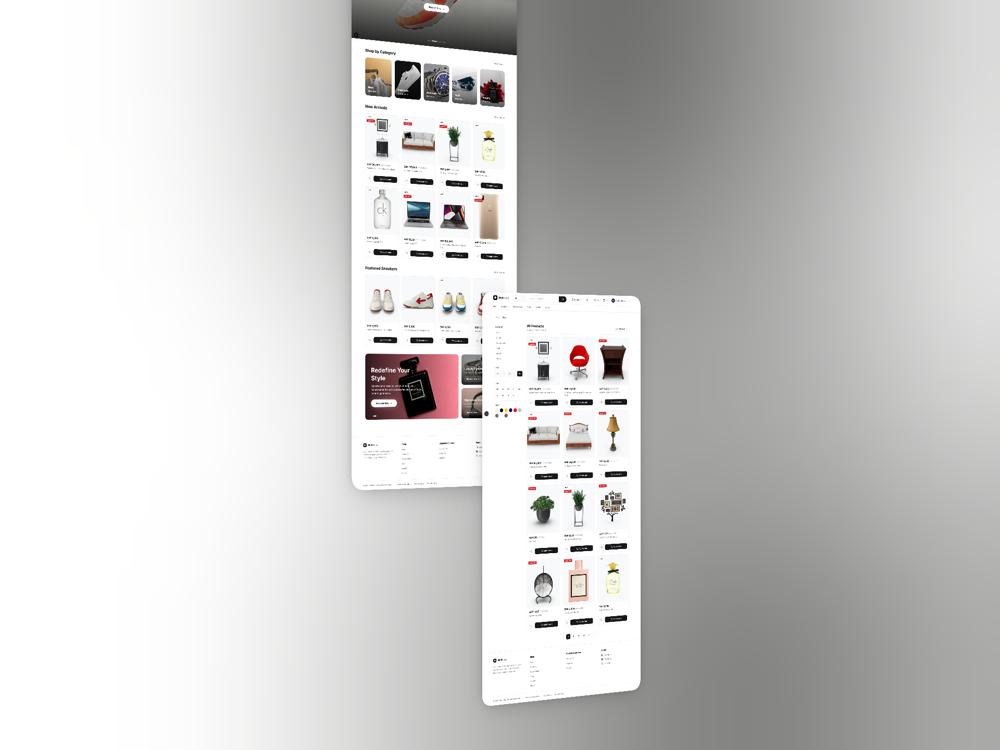

# ShiftSouq E-Commerce Platform



ShiftSouq is a premium, full-featured e-commerce platform built with cutting-edge web technologies. It provides a seamless, responsive, and bilingual shopping experience for customers while offering a robust, dynamic administrative dashboard for business owners.

## 🌟 Key Features

*   **Modern Framework**: Built with **Next.js 16 (App Router)** and **React 19** for blazing fast performance and server-side rendering.
*   **Database & Authentication**: Powered by **Supabase** (PostgreSQL) for secure user authentication, product management, and real-time database capabilities.
*   **Secure Payments**: Integrated with **Paymob** supporting both Credit/Debit Cards and Mobile Wallets, complete with secure HMAC webhook verification.
*   **Bilingual & RTL Support**: Full localization supporting both **English** and **Arabic**, including Right-to-Left (RTL) layout styling.
*   **Dynamic Admin Dashboard**: A dedicated, role-based admin shell to efficiently manage products, inventory variants, orders, and payment statuses.
*   **Premium UI/UX**: Styled with **Tailwind CSS v4** and animated with **Framer Motion**. Includes custom components, slide-over modals, and toast notifications via **Sonner**.
*   **State Management**: Efficient global state handling using **Zustand**.
*   **Robust Forms**: Form handling and schema validation using **React Hook Form** and **Zod**.

## 🛠 Tech Stack

*   **Frontend**: Next.js, React, Tailwind CSS, Framer Motion, Lucide Icons, Swiper.
*   **Backend / BaaS**: Supabase (Auth, Postgres Database, Storage).
*   **State Management**: Zustand.
*   **Payments**: Paymob API.
*   **Validation**: Zod.

## 📂 Project Structure

```text
shift-souq/
├── app/                  # Next.js App Router (Pages, Layouts, API routes)
│   ├── (auth)/           # Authentication routes (Login, Register)
│   ├── [locale]/         # Internationalization wrapper
│   ├── admin/            # Secure Admin Dashboard routes
│   ├── api/              # API endpoints (e.g., Paymob Webhooks)
│   ├── cart/             # Shopping Cart
│   ├── checkout/         # Checkout flow
│   ├── product/          # Product detail pages
│   ├── shop/             # Global shop & filtering
│   └── ...
├── components/           # Reusable UI components (Shared, UI, Admin, etc.)
├── lib/                  # Utility functions, constants, state store, validations
├── public/               # Static assets (Images, Fonts, Icons)
└── supabase/             # Database schemas, migrations, and seed data
```

## 🚀 Getting Started

### Prerequisites

*   **Node.js** (v18 or higher recommended)
*   **npm**, **yarn**, **pnpm**, or **bun**
*   A **Supabase** account and project
*   A **Paymob** account for payment gateway credentials

### Installation

1.  **Clone the repository:**
    ```bash
    git clone https://github.com/abdelrahman-samy-dev/shiftsouq-ecommerce.git
    cd shift-souq
    ```

2.  **Install dependencies:**
    ```bash
    npm install
    # or yarn install / pnpm install / bun install
    ```

3.  **Environment Variables:**
    Create a `.env.local` file in the root directory and configure the necessary variables (Refer to `.env.example` if available). Required variables typically include:
    *   `NEXT_PUBLIC_SUPABASE_URL`
    *   `NEXT_PUBLIC_SUPABASE_ANON_KEY`
    *   `PAYMOB_API_KEY`
    *   `PAYMOB_HMAC_SECRET`
    *   `PAYMOB_INTEGRATION_ID`
    *   `PAYMOB_IFRAME_ID`

4.  **Database Setup:**
    Execute the SQL scripts found in the `supabase/` folder (`schema.sql`, `security-patches.sql`, `seed.sql`) in your Supabase SQL Editor to set up the required tables, policies, and initial data.

5.  **Run the development server:**
    ```bash
    npm run dev
    ```

    Open [http://localhost:3000](http://localhost:3000) with your browser to see the result.

## 🛡️ Security & Roles

*   **Row Level Security (RLS)**: Supabase RLS is extensively used to ensure users can only access their own data (orders, profiles, wishlists).
*   **Admin Access**: The `/admin` routes are protected and verify user roles before granting access to the management dashboard.
*   **Webhook Verification**: The Paymob webhook endpoint securely validates incoming requests using HMAC hashing to prevent unauthorized access.

## 🤝 Contributing

Contributions are welcome! Please feel free to submit a Pull Request or open an issue if you encounter any bugs or have feature requests.

## 📄 License

This project is proprietary and confidential. All rights reserved.
